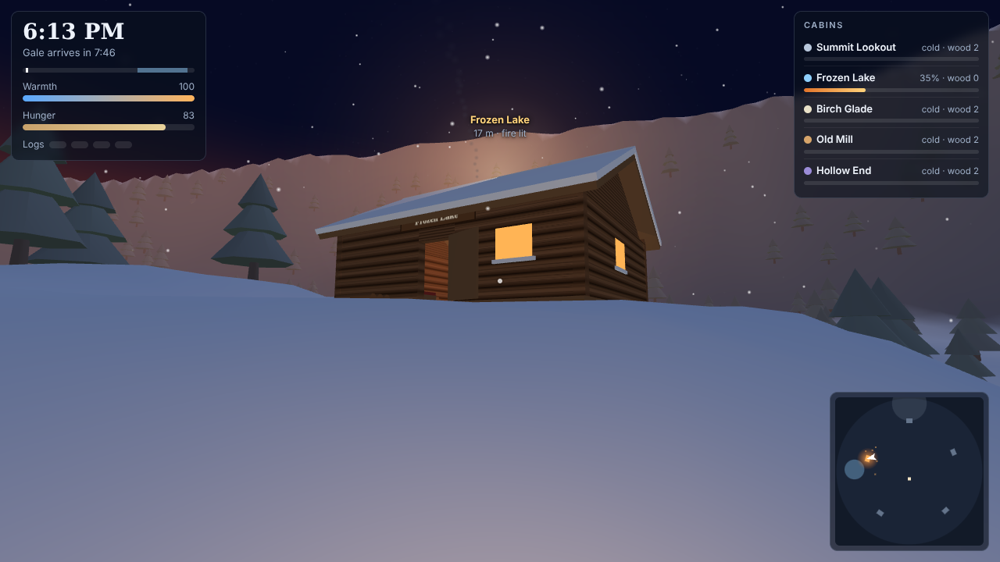

# Frostfall Cabins

A LAN multiplayer spin-off of Fernlight Frostfall. Five log cabins sit in different corners of one mountain valley — **Summit Lookout**, **Frozen Lake**, **Birch Glade**, **Old Mill** and **Hollow End**. Everyone on your Wi-Fi joins the same night, splits up between the cabins, hauls firewood, and tries to keep every stove burning through the **2:00 AM icy gale** until dawn.

## Start a game

One computer runs the server (a Raspberry Pi is plenty). Nothing to install — it only needs Python 3.

- **Raspberry Pi / Linux / Mac:** double-click `start-pi.sh` (or run `./start-pi.sh` in a terminal)
- **Windows:** double-click `start-windows.bat` (Python 3 must be installed)

The window prints an address like `http://192.168.1.42:8790`. Everyone opens that address in Chrome/Chromium on their own computer or Pi and picks a name and coat colour. The server computer can play too at `http://localhost:8790`.

Options: `python3 server.py --minutes 20` for a longer night (default 12), `--day 3` to start on day 3, `--day-minutes 10` for longer daylight, `--port 9000` to change the port.

## The story (5 days)

Time runs continuously. Day 1 starts at 6 PM; every later day starts at **6 AM, the morning after the gale**, in the same world (fires, wood and tools carry over). Daylight lasts 8 real minutes, nights 12.

| Day | What happens |
|---|---|
| **1** | Spread out across the five cabins. Haul firewood, light the stoves, heat cans of stew, survive the **2:00 AM icy gale**. A big **bonfire** at the trailhead keeps you somewhat warm — until the gale blows it out (relight it with a log). |
| **2** | **Animals** roam the valley. An **axe** is stuck in the chopping block outside every cabin. Chase down deer and rabbits (they tire out), then cook the meat. |
| **3** | **Fishing.** Rods are on the Frozen Lake dock (and at Old Mill and Hollow End). Fish through the ice holes, cook the catch. |
| **4** | A broken **helicopter** sits on the pad between the Summit and Birch Glade. Race to bring its **battery** (Summit Lookout), **fuel can** (Old Mill) and **rotor blade** (Hollow End) and start it. Then **fly it**: one player takes the controls, up to four more hop in, and you tour the valley from the air. |
| **5** | **9:00 AM air-raid sirens.** Get to a cabin's **solar radio** to hear where the valley's **only bunker** is (or fly there in the helicopter). At **10:33 AM a Russian hydrogen bomb** hits the valley. In the bunker: a **TV** on a car battery shows the live summit camera, shelves of **canned food**, **5 electric burners** on a battery bank, and **Geiger counters**. The hatch stays locked for **2 hours**; then climb out into a flattened valley — every cabin is a burning ruin, the forest is blown flat or snapped into charred stumps, the ground is scorched black around ground zero, black smoke columns rise everywhere, the helicopter is a wreck, and the Geiger counter clicks while every step kicks up floating dust. The story ends at 6 PM. |

After day 5 the story starts again from day 1.

## Controls

| Key | Does |
|---|---|
| WASD / arrows | walk · **Shift** run · **Space** jump |
| Mouse | look (click the game to grab the mouse, Esc to free it) · **wheel** zooms in/out, middle-click resets |
| **E** or **click** | pick up / use — doors, bonfire, logs, woodbox, stove, cans, candles, radio, axe, rods, ice holes, helicopter, bunker hatch. With an axe, click to swing. |
| **1 / 2 / 3** | at a stove or burner: cook venison / trout / a can |
| **− / =** · **N** | volume down / up · mute (or use the slider) |
| **T** | chat · **Tab** who's where · **M** big map |

**Helicopter (once it's running):** press **E** at it to take the controls (or hop in as a passenger if someone already has them). Pilot: **W/S** forward/back · **A/D** turn · **Space** climb · **Shift** (or C) descend. Land, then **E** to hop out. During the day-5 sirens, **F** at the helicopter sets the autopilot to the bunker.

**Sleeping through the night:** press E at a cabin bed to vote. When every player has voted, is inside a cabin, and every occupied cabin's stove plus its woodbox has enough wood to last till 6 AM, everyone sleeps and wakes at dawn (the server tells you how many more logs are needed).

**Food:** the pantries and bunker shelves hold labelled cans — beef stew, Spam, sausage soup, pork & beans and mixed vegetables. Venison, rabbit and trout cook on a metal plate and brown as they cook.

Tips: walk up to a log and you pick it up automatically. Things you can pick up glow. A closed cabin door keeps the heat in. Warmth drains outdoors (much faster in the gale); a lit stove warms you, candles help a little. Freeze solid and you thaw out 10 seconds later by the strongest fire.

**Host commands** (type in chat): `/day 1`–`/day 5` jump to a day, `/skip` jump to the next morning, `/time 9:00` set the clock, `/give` hand yourself some meat and fish to test cooking, `/heli` get the helicopter running straight away.

## Files

- `server.py` — game server and web server in one file (Python standard library only)
- `public/` — the game itself (three.js is bundled, so it works with no internet)
